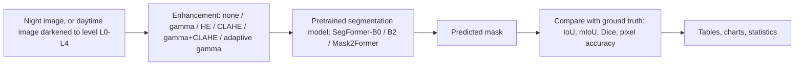

# Improving Image Segmentation in Low-Light Conditions Using Lightweight Image Enhancement Techniques

B.Tech CSE final-year project, GLA University, Mathura (session 2026–27).

_Group member and supervisor names will be added when the project is complete._

## What and why

Segmentation models label every pixel of a street image as road, car, person, sky and so on.
They are trained mostly on daytime photos, so they lose accuracy at night: contrast falls, object
edges fade and camera noise rises.

This project tests whether simple, fast image enhancement (gamma correction, histogram
equalization, CLAHE and combinations), applied **before** a pretrained model such as SegFormer,
can recover some of that accuracy **without retraining the model**. It also builds an adaptive
selector that picks the best enhancement for each image (including "do nothing"), and a web demo.

The full specification is in [docs/PID.md](docs/PID.md). Progress and decisions are in
[docs/PROGRESS.md](docs/PROGRESS.md).

## Research questions

| ID | Question |
|---|---|
| RQ1 | Does classical enhancement improve a daytime model's mIoU on **real** night images? |
| RQ2 | On **synthetically darkened** images, how much accuracy is lost at each darkness level, and how much does each method recover? |
| RQ3 | Which parameter values (gamma, CLAHE clip limit and tile size) work best? |
| RQ4 | Which object classes benefit most? |
| RQ5 | Are the methods fast enough for real-time use on a CPU? |
| RQ6 | Does a per-image adaptive selector beat the best single fixed method? |

Earlier research found that this kind of test-time enhancement often does **not** help on real
night images. A negative answer to RQ1 is a valid result and will be reported honestly.

## Pipeline



| Part | Choice |
|---|---|
| Real night data | ACDC night (tuning on train, 400 images; reporting on val, 106 images) |
| Controlled data | Cityscapes val (500 daytime images darkened to 5 known levels) |
| Models (inference only, never retrained) | SegFormer-B0 (main), SegFormer-B2, Mask2Former Swin-Tiny |
| Enhancement | Gamma, HE, CLAHE, Gamma + CLAHE, adaptive gamma (OpenCV) |
| Statistics | Paired bootstrap 95% confidence intervals, Wilcoxon signed-rank test |
| Demo | Streamlit web app |

## Where things run (everything heavy is in the cloud, all free)

| What | Where |
|---|---|
| Code editing, unit tests, linting | Laptop (VS Code, light Python environment, no PyTorch, no datasets) |
| Datasets | Your private Google Drive (only the parts we use) |
| Model downloads and every model run | Google Colab free GPU (Kaggle Notebooks as a free backup) |
| Results | Written to Google Drive during runs; small CSV/JSON summaries copied back into `results/` |

Free Colab sessions can disconnect. The experiment runner is **resumable**: it saves after each
step and skips finished work, so a dropped session loses at most a few minutes.

## Setup on the laptop (Windows PowerShell)

The laptop only needs the code and a small environment for tests. Keep the project **outside
OneDrive** and in a **short path** (for example `C:\Projects\lowlight-seg`). Windows limits paths
to 260 characters unless "long path support" is enabled, and long project paths can make
`pip install` fail with "No such file or directory".

1. Install **Python 3.12** from [python.org](https://www.python.org/downloads/) (tick
   "Add python.exe to PATH"), or run `winget install -e --id Python.Python.3.12`. Install
   [Git](https://git-scm.com/download/win).
2. Create and activate a virtual environment in the project folder:
   ```powershell
   cd C:\Projects\lowlight-seg
   py -3.12 -m venv .venv
   .\.venv\Scripts\Activate.ps1
   python -m pip install --upgrade pip
   ```
   If PowerShell says running scripts is disabled, run this once and try again:
   `Set-ExecutionPolicy -Scope CurrentUser RemoteSigned`
3. Install the light packages and the project itself:
   ```powershell
   pip install numpy==2.5.5 pyyaml==6.0.3 opencv-python-headless==5.1.0.95 pytest==9.2.0 ruff==0.17.5
   pip install -e . --no-deps
   ```
4. Check that everything works:
   ```powershell
   pytest
   ruff check .
   ```

**Linux / macOS:** the same steps, but create and activate the environment with
`python3.12 -m venv .venv && source .venv/bin/activate`.

The full package list (PyTorch, Transformers, OpenCV and so on) is in `requirements.txt` and is
installed automatically by the Colab notebook. You can also install it locally if you want to
run models on your own machine: install PyTorch from
[pytorch.org](https://pytorch.org/get-started/locally/) first, then `pip install -r requirements.txt`.

## Datasets

See [docs/DATA.md](docs/DATA.md) for how to register, download and store each dataset. Datasets
are licensed for non-commercial research only and are never committed to Git or shared publicly.

## How to run

Commands are added as milestones are completed (see [docs/EXPERIMENTS.md](docs/EXPERIMENTS.md)).

**Send the code to Colab** (no GitHub needed): commit your changes, then run
```powershell
.\scripts\pack_code.ps1
```
and upload the created `lowlight-code.zip` to `My Drive/lowlight-seg/code/`.

**Prepare and check the data (once):** upload `notebooks/colab_data_setup.ipynb` to
[Google Colab](https://colab.research.google.com) (File → Upload notebook) and run it. It ends with
the data check:
```
python -m lowlight.cli check-data --deep
```
which confirms ACDC night train 400 / val 106 and Cityscapes val 500, with a label for every image.

## Repository layout

```
configs/            YAML settings (defaults, darkness levels, experiments)
src/lowlight/       the Python package (config, labels, datasets, enhancement, models, metrics, ...)
tests/              pytest tests (run on the laptop; slow model tests run on Colab)
notebooks/          Colab notebooks for data download and experiment runs
scripts/            data checks, darkness calibration, report assets
app/                Streamlit demo
docs/               specification, progress log, data guide, plain-English explanations for the viva
results/            CSV/JSON results (images and large files are not stored in Git)
```

## Results

Not yet run.

## Credits

- The idea extends [mraknar/low-light-coin-segmentation](https://github.com/mraknar/low-light-coin-segmentation),
  which compares gamma, CLAHE, HE and a combined method on coin images. No code was copied from it.
- Datasets: ACDC (Sakaridis et al., ICCV 2021), Cityscapes (Cordts et al., CVPR 2016),
  Dark Zurich (Sakaridis et al., 2020). Used under their non-commercial research licences and
  not included in this repository.
- Models: SegFormer (Xie et al., NeurIPS 2021) and Mask2Former (Cheng et al., CVPR 2022) via
  Hugging Face `transformers`.

The full reference list is in [docs/PID.md, Section 17](docs/PID.md).
