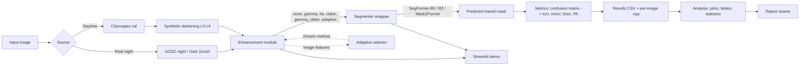

# Project Implementation Document (PID)

**Project:** Improving Image Segmentation in Low-Light Conditions Using Lightweight Image Enhancement Techniques
**Type:** B.Tech CSE final-year group project, GLA University, Mathura (session 2026–27)
**Owner:** Abhay Kumar Dwivedi (with group members; names to be filled in)
**Document version:** 1.1, 19 November 2026 (adds a progress log, Windows setup, disk space, Git workflow, concrete sanity checks and a "not covered" list)
**Audience:** the project group and the supervisor

---

## 0. Working rules

This is a research-style Python project. Read this whole document before writing any code. Then work through the milestones in Section 14 in order.

Rules we follow:

1. **Build one milestone at a time.** At the end of each milestone, run the tests, write a short summary of what was built and what the outputs look like, and review it as a group before starting the next milestone.
2. **Never invent results.** Every number in a table, chart, README or report draft must come from a file in `results/` produced by code in this repository. If an experiment has not been run, write "not yet run".
3. **Never train or fine-tune the segmentation models.** The whole point of the project is to improve segmentation *without retraining*. The only thing that may be trained is the small adaptive selector classifier in Section 9.8.
4. **Never tune parameters on the evaluation split.** Tuning uses the ACDC night *train* split. Final numbers are reported on the ACDC night *val* split. See Section 8.
5. **Never commit datasets, model weights or result images to Git.** They are large and the datasets have non-commercial licences. Use `.gitignore`.
6. **Explain as you build.** The students must be able to explain every line in their viva. For every module, write a short plain-English explanation file in `docs/explanations/` (see Section 11.4) and comment the non-obvious lines in the code.
7. **Check, do not guess.** If a dataset file layout, model output format or library API differs from what this document says, check the real files or docs, adapt the code, and write down what was different.
8. **Write normal, simple English** in all docs, comments and UI text.
9. **Keep a progress log.** This project runs over several months, so keep `docs/PROGRESS.md` up to date: current milestone, what is done, what is next, open problems, and a dated **decision log** (every deviation from this PID, for example a different file layout or a changed parameter, with what and why). Read it before starting each work session.
10. **Use Git properly.** Initialise Git in M0. Commit after each completed sub-task with a clear message, and make a tagged commit (`m0-done`, `m1-done`, ...) at every approved checkpoint. Never commit anything listed in `.gitignore`.
11. **Develop on small runs.** During development use only small runs (`--limit 20` or less). Full experiments are run on Colab with the exact commands written in the docs, and the saved outputs are analysed afterwards.
12. **We work on Windows with VS Code.** Every command in the docs must work in PowerShell; where Linux/macOS/Colab differ, give both versions. Use `pathlib` everywhere in code, never hard-coded `/` or `\` paths.

---

## 1. Project summary

Semantic segmentation models (models that label every pixel of an image as road, car, person, sky and so on) are trained mostly on daytime images. At night their accuracy drops because contrast falls, object boundaries fade and sensor noise rises.

This project measures whether **simple, fast, classical image enhancement applied before segmentation** can recover some of that lost accuracy **without retraining the model**.

The pipeline:

1. Take a low-light image (a real night image, or a daytime image darkened in a controlled way).
2. Create several enhanced versions: Gamma Correction, Histogram Equalization (HE), CLAHE (Contrast Limited Adaptive Histogram Equalization) and Gamma + CLAHE, plus the unenhanced original.
3. Pass every version through the same pretrained segmentation model (SegFormer, plus comparison models).
4. Compare each predicted mask with the ground-truth mask using IoU (Intersection over Union), mean IoU (mIoU), Dice coefficient and pixel accuracy.
5. Analyse which method helps, for which object classes, at which darkness level, and at what speed on a normal CPU.
6. Build an **adaptive selector** that picks the best enhancement for each image automatically.
7. Build a **Streamlit web demo** that shows original, enhanced and segmented images side by side.

Starting point and credit: the idea extends the GitHub project `mraknar/low-light-coin-segmentation`, which compares Gamma, CLAHE, HE and a combined method on coin images using classical thresholding and IoU/Dice. This project moves from coins and thresholding to real street scenes and pretrained deep learning models. Do not copy code from that repository unless its licence allows it; if any code is reused, credit it in the README.

---

## 2. Research questions and hypotheses

| ID | Research question | Hypothesis | Experiment |
|---|---|---|---|
| RQ1 | Does classical enhancement improve the mIoU of a pretrained daytime model on **real** night images? | Small or mixed effect; some methods may even reduce mIoU | E1 |
| RQ2 | On **synthetically darkened** images, how much accuracy is lost at each darkness level, and how much does each method recover? | Gamma and Gamma + CLAHE recover a large share of the loss at moderate darkness; recovery shrinks at extreme darkness because of noise | E2 |
| RQ3 | What are the best parameter values (gamma value, CLAHE clip limit and tile size)? | A moderate gamma (around 0.4 to 0.6) and a low clip limit (around 2) work best | E3 |
| RQ4 | Which object classes benefit most? | Large, low-texture classes (road, sky, building) gain less; small or dark objects (person, traffic sign, pole) are most affected | E4 |
| RQ5 | Are the methods fast enough for real-time use on a CPU? | Every classical method runs in a few milliseconds per image, far below the cost of segmentation | E5 |
| RQ6 | Does an adaptive per-image selector beat the best single fixed method? | Yes, by a small margin, and it can learn to choose "no enhancement" when enhancement would hurt | E6 |

**Important honesty note (put this in the report too).** Earlier research found that test-time pre-processing such as CLAHE and Zero-DCE did *not* help a daytime segmentation model on real night images, because the enhanced night images still look different from the daytime images the model was trained on (Sakaridis et al., 2020, "Map-Guided Curriculum Domain Adaptation and Uncertainty-Aware Evaluation for Semantic Nighttime Image Segmentation"). A 2023 study from Tianjin University reached a similar conclusion. So RQ1 may give a negative or mixed answer. **That is a valid research result.** The project is designed so that it still produces clear findings either way: the controlled-darkness benchmark (RQ2), the class-wise analysis (RQ4), the speed study (RQ5) and the adaptive selector (RQ6), which can learn when *not* to enhance.

---

## 3. Scope

**In scope**
- Classical enhancement: Gamma, HE, CLAHE, Gamma + CLAHE, adaptive gamma.
- Pretrained segmentation models used as-is (inference only).
- Real night dataset (ACDC night) and controlled synthetic darkening (Cityscapes val).
- Metrics, statistics, plots, class-wise analysis, timing.
- Adaptive selector (rule-based and a small learned classifier).
- Streamlit demo, CLI, tests, documentation, report-ready figures and tables.

**Stretch goals (only after the core is done and approved)**
- Zero-DCE++ (a tiny deep-learning enhancer with about 10K parameters) as a "lightweight deep" comparison, using official pretrained weights.
- AGCWD (Adaptive Gamma Correction with Weighting Distribution, Huang et al., 2013).
- Dark Zurich val set as a second real-night test set.
- DeepLabV3 evaluated on the classes it shares with Cityscapes (Section 9.4).

**Out of scope**
- Training or fine-tuning any segmentation model.
- Domain adaptation methods.
- Video processing, mobile apps, cloud deployment beyond an optional free Streamlit host.

---

## 4. Glossary (use these exact meanings in code and docs)

| Term | Meaning |
|---|---|
| Semantic segmentation | Assigning a class label to every pixel |
| trainId | The 0–18 class index used by Cityscapes-style datasets; 255 means "ignore this pixel" |
| IoU | For one class: TP / (TP + FP + FN), where TP = true positive pixels, FP = false positive, FN = false negative |
| mIoU | Mean of per-class IoU over the classes present (19 Cityscapes classes) |
| Dice | For one class: 2TP / (2TP + FP + FN) |
| Pixel accuracy | Correct pixels / all non-ignored pixels |
| Gamma correction | `out = 255 * (in / 255) ** gamma`; gamma < 1 brightens dark pixels |
| HE | Histogram Equalization: spreads brightness values across the full 0–255 range |
| CLAHE | Contrast Limited Adaptive Histogram Equalization: HE done on small tiles, with a clip limit that stops noise being over-boosted |
| Darkness level | One of L0–L4, our controlled synthetic darkening settings (Section 9.2) |
| Oracle | The best method for an image, chosen by looking at the ground truth; an upper bound, never available at test time |

---

## 5. System architecture



Design principles:
- Every enhancement method and every model sits behind a small, common interface, so new ones can be added by registering one function or class.
- Experiments are driven by YAML config files, are seeded, and are **resumable** (they skip work whose outputs already exist).
- Per-image confusion matrices are saved, so any metric can be recomputed later without running the models again.

---

## 6. Tech stack and environment

| Item | Choice | Notes |
|---|---|---|
| Python | 3.12 (3.11 also fine) | PyTorch 2.15 drops Python 3.10 wheels, so do not use 3.10 |
| Deep learning | PyTorch ≥ 2.10, torchvision | CPU build is fine; CUDA build on Colab |
| Models | Hugging Face `transformers` ≥ 5.0 | Transformers v5 changed some APIs; follow the current SegFormer and Mask2Former docs |
| Image processing | `opencv-python-headless`, `numpy`, `scikit-image`, `Pillow` | |
| Data and stats | `pandas`, `scipy`, `scikit-learn` | scikit-learn is for the selector classifier |
| Plots | `matplotlib` | |
| Config | `pyyaml` | |
| Demo | `streamlit` | |
| Progress bars | `tqdm` | |
| Testing and quality | `pytest`, `ruff` | |
| Hardware | Laptop CPU (i5 / Ryzen 5, 8–16 GB RAM); Google Colab GPU for the full experiment runs | |

**Local setup to document in the README (Windows PowerShell first):**
1. Install Python 3.12 from python.org (tick "Add python.exe to PATH") and Git.
2. `py -3.12 -m venv .venv` then `.\.venv\Scripts\Activate.ps1` (if PowerShell blocks scripts: `Set-ExecutionPolicy -Scope CurrentUser RemoteSigned`). On Linux/macOS: `python3.12 -m venv .venv && source .venv/bin/activate`.
3. Install the **CPU** build of PyTorch using the command from pytorch.org's "Get Started" selector (laptops without an NVIDIA GPU), then `pip install -r requirements.txt`.
4. The first model run downloads weights from Hugging Face automatically (no account or token needed for these public models); it needs internet once and then uses the local cache.

**Disk space:** about 25 GB free. Cityscapes `leftImg8bit_trainvaltest.zip` alone is about 11 GB (we only keep the val images after extraction; the train and test folders can be deleted to save space). ACDC night, model weights, the virtual environment and results take several more GB.

When creating `requirements.txt`, check the latest versions that install together (`pip index versions <pkg>`), then **pin exact versions** that you have tested, so results are reproducible. Record the pinned versions and the machine used in `results/ENVIRONMENT.md`.

---

## 7. Repository layout

```
lowlight-seg/
├── README.md                     # What, why, setup, how to run, results summary, credits
├── requirements.txt              # Pinned
├── pyproject.toml                # Package config, ruff config
├── .gitignore                    # data/, weights/, results/**/*.png, .venv, __pycache__
├── configs/
│   ├── default.yaml              # Paths, device, inference size, seeds
│   ├── darkness_levels.yaml      # L0-L4 parameters
│   ├── enhance_grid.yaml         # Parameter sweep grid (E3)
│   └── experiments/
│       ├── e1_real_night.yaml
│       ├── e2_controlled_darkness.yaml
│       ├── e3_param_sweep.yaml
│       ├── e4_classwise.yaml     # analysis only, reuses E1/E2 outputs
│       ├── e5_speed.yaml
│       └── e6_selector.yaml
├── data/                         # NOT in Git. See Section 8.
├── src/lowlight/
│   ├── __init__.py
│   ├── config.py                 # Load and validate YAML
│   ├── labels.py                 # 19 classes, palette, labelId->trainId map, VOC mapping
│   ├── datasets.py               # ACDC, Cityscapes, Dark Zurich, folder-of-images loaders
│   ├── darken.py                 # Synthetic low-light generation
│   ├── enhance.py                # Enhancement registry and methods
│   ├── features.py               # Image statistics for the selector
│   ├── models.py                 # Segmenter interface + implementations
│   ├── metrics.py                # Confusion matrix and all metrics
│   ├── stats.py                  # Bootstrap CIs, Wilcoxon test
│   ├── selector.py               # Rule-based and learned selector
│   ├── timing.py                 # Speed measurement helpers
│   ├── viz.py                    # Colour masks, overlays, grids, error maps, charts
│   ├── runner.py                 # Generic experiment runner (resumable)
│   └── cli.py                    # Command-line entry points
├── app/
│   └── streamlit_app.py          # Web demo
├── scripts/
│   ├── check_data.py             # Verifies dataset layout and counts
│   ├── calibrate_darkness.py     # Compares synthetic levels to real night statistics
│   └── make_report_assets.py     # Builds final tables and figures
├── notebooks/
│   └── 01_explore.ipynb          # Exploration only; never the source of truth
├── tests/                        # pytest unit and smoke tests
├── results/                      # Outputs (CSV in Git; images ignored)
└── docs/
    ├── PID.md                    # This document
    ├── DATA.md                   # How to download and place each dataset
    ├── EXPERIMENTS.md            # What each experiment does and how to run it
    └── explanations/             # Plain-English module explanations for the viva
```

---

## 8. Datasets

All three datasets need a **manual download** by a student (they ask you to log in or accept terms, and their licences are for non-commercial research). The code must not try to scrape or mirror them. Write `docs/DATA.md` with step-by-step download instructions and the expected folder layout, and write `scripts/check_data.py` to verify counts and file pairing.

### D1. ACDC night (main real-night dataset)
- Source: https://acdc.vision.ee.ethz.ch (ACDC: Adverse Conditions Dataset with Correspondences).
- The night condition has pixel-level labels for 400 train images and 106 val images; test labels are not public (test has 500 images).
- Labels use the 19 Cityscapes classes (trainIds, 255 = ignore).
- **Usage rule:**
  - `night/train` (400 images) = **tuning set**: parameter sweep (E3) and training the learned selector (E6).
  - `night/val` (106 images) = **held-out evaluation set**: all headline numbers.
  - `night/test` is not used (no public labels).
- Expected layout (verify after download; adapt the loader if different):
  ```
  data/acdc/rgb_anon/night/{train,val}/<sequence>/*_rgb_anon.png
  data/acdc/gt/night/{train,val}/<sequence>/*_gt_labelTrainIds.png
  ```
- ACDC also ships "invalid region" masks for uncertainty-aware evaluation. Standard semantic segmentation evaluation uses `*_gt_labelTrainIds.png` with 255 ignored. Use that.

### D2. Cityscapes val (for controlled synthetic darkening)
- Source: https://www.cityscapes-dataset.com (needs a free account; academic email recommended).
- Files: `leftImg8bit_trainvaltest.zip` and `gtFine_trainvaltest.zip`. Only the **val** split (500 images, cities frankfurt, lindau, munster) is used.
- Expected layout:
  ```
  data/cityscapes/leftImg8bit/val/<city>/*_leftImg8bit.png
  data/cityscapes/gtFine/val/<city>/*_gtFine_labelIds.png
  ```
- Convert `labelIds` to `trainIds` in code using the table in Section 9.1 (no need for the `cityscapesscripts` package).
- These images are well-lit, so we darken them to known levels. This gives a **controlled** experiment: same scene, same labels, only the lighting changes.
- If Cityscapes access is delayed, start with ACDC (D1) and add D2 later. Do not substitute an unlabelled dataset.

### D3. Dark Zurich val (stretch, second real-night set)
- 50 labelled night images (val split); test labels are withheld.
- Source: https://www.trace.ethz.ch/publications/2019/GCMA_UIoU/ (verify the current link).
- Used only as a cross-dataset check for the best methods found on ACDC.

### Development subset
For fast development on a CPU, the loaders must support `limit: N` and a fixed `seed` in the config so the same subset is always used (for example 20 images while coding, the full split for final runs).

---

## 9. Module specifications

### 9.1 `labels.py`

The 19 Cityscapes classes in trainId order, with the standard Cityscapes colour palette (RGB):

| trainId | Class | RGB |
|---|---|---|
| 0 | road | (128, 64, 128) |
| 1 | sidewalk | (244, 35, 232) |
| 2 | building | (70, 70, 70) |
| 3 | wall | (102, 102, 156) |
| 4 | fence | (190, 153, 153) |
| 5 | pole | (153, 153, 153) |
| 6 | traffic light | (250, 170, 30) |
| 7 | traffic sign | (220, 220, 0) |
| 8 | vegetation | (107, 142, 35) |
| 9 | terrain | (152, 251, 152) |
| 10 | sky | (70, 130, 180) |
| 11 | person | (220, 20, 60) |
| 12 | rider | (255, 0, 0) |
| 13 | car | (0, 0, 142) |
| 14 | truck | (0, 0, 70) |
| 15 | bus | (0, 60, 100) |
| 16 | train | (0, 80, 100) |
| 17 | motorcycle | (0, 0, 230) |
| 18 | bicycle | (119, 11, 32) |
| 255 | ignore | (0, 0, 0) |

Cityscapes `labelId` → `trainId` map (every other labelId → 255):
`7→0, 8→1, 11→2, 12→3, 13→4, 17→5, 19→6, 20→7, 21→8, 22→9, 23→10, 24→11, 25→12, 26→13, 27→14, 28→15, 31→16, 32→17, 33→18`.

Implement the map as a 256-entry NumPy lookup table so conversion is one indexing operation.

Also define `VOC_TO_TRAINID` for the optional DeepLabV3 evaluation (Section 9.4).

At model load time, **assert** that each model's `id2label` names match this class list in order (after lowercasing and normalising spaces/underscores). If they do not match, build an explicit remapping and log it.

### 9.2 `darken.py` — synthetic low-light generation

Function: `darken(img_rgb_uint8, level: str, seed: int, noise: bool = True) -> img_rgb_uint8`

Model (all maths in float, values scaled to 0–1):
1. `x = img / 255`
2. Brightness and contrast drop: `d = alpha * x ** g`
3. If `noise`: shot noise (Poisson) `d = poisson(d * peak) / peak`, then read noise (Gaussian) `d = d + normal(0, sigma)`
4. Clip to [0, 1], multiply by 255, round to uint8.

This "gamma darkening plus Poisson–Gaussian noise" approach is standard in low-light research (see the low-light enhancement survey by Li et al., 2021). Use a NumPy `Generator` seeded per image (`seed + hash(image_id)`) so results are reproducible.

Starting values (`configs/darkness_levels.yaml`). These are **starting points to calibrate**, not fixed truths:

| Level | alpha | g | peak (photons) | sigma | Meaning |
|---|---|---|---|---|---|
| L0 | 1.0 | 1.0 | — | — | Original, no change |
| L1 | 0.70 | 1.5 | 400 | 0.005 | Dusk |
| L2 | 0.50 | 2.0 | 200 | 0.010 | Poorly lit street |
| L3 | 0.35 | 2.5 | 100 | 0.015 | Night with street lights |
| L4 | 0.20 | 3.0 | 50 | 0.020 | Very dark |

Calibration (`scripts/calibrate_darkness.py`): compute mean luminance (L channel of LAB) and RMS contrast for ACDC night train images, and for Cityscapes val at each level. Adjust alpha and g so that L3 and L4 bracket the real ACDC night mean luminance. Save a histogram comparison figure and write the final values back to the YAML with a comment saying they were calibrated.

Also support `noise=False` to run a "brightness only" ablation (separates the effect of darkness from the effect of noise).

### 9.3 `enhance.py` — enhancement methods

Interface: `enhance(img_rgb_uint8, method: str, **params) -> img_rgb_uint8` (same shape and dtype as the input). Implement with a registry: `@register("clahe") def clahe(img, clip_limit=2.0, tile_grid=8): ...`.

| Method key | What it does | Default params | Implementation notes |
|---|---|---|---|
| `none` | Returns the input unchanged | — | Baseline |
| `gamma` | `255 * (x/255) ** gamma` on all three channels | `gamma=0.5` | Use a 256-entry lookup table and `cv2.LUT` (fast) |
| `he` | Global histogram equalization | — | Convert RGB → LAB, `cv2.equalizeHist` on L only, convert back. Equalizing each RGB channel separately shifts colours, so do not do that |
| `clahe` | Tile-wise equalization with a clip limit | `clip_limit=2.0, tile_grid=8` | `cv2.createCLAHE` on the L channel of LAB, convert back |
| `gamma_clahe` | Gamma, then CLAHE | both of the above | Order matters: gamma first |
| `adaptive_gamma` | Chooses gamma from the image's own brightness | `target_mean=0.45, min_gamma=0.25, max_gamma=1.0` | `m = mean(L)/255`; `gamma = log(target_mean) / log(m)`, clipped to [min, max]; if `m >= target_mean`, gamma = 1.0 |
| `agcwd` (stretch) | Huang et al. 2013 adaptive gamma | `alpha=0.5` | Implement from the paper on the V or L channel |
| `zero_dce_pp` (stretch) | Tiny pretrained CNN enhancer | official weights | Only if official weights are available and the licence allows it; put weights in `weights/` (ignored by Git) |

Requirements:
- Guard against edge cases: all-black image, all-white image, single-colour image, odd sizes, grayscale input (convert to 3-channel).
- Each method must be deterministic.
- Each method must have a docstring with the formula and a one-line analogy (for viva prep).

### 9.4 `models.py` — segmenter wrappers

Common interface:

```python
class Segmenter(Protocol):
    name: str
    num_classes: int  # 19 for Cityscapes models
    def predict(self, img_rgb_uint8: np.ndarray) -> np.ndarray:  # HxW uint8 trainIds
        ...
```

Implementations:

| Key | Hugging Face / torchvision ID | Role |
|---|---|---|
| `segformer_b0` | `nvidia/segformer-b0-finetuned-cityscapes-1024-1024` | **Primary model.** About 3.7M parameters; 76.2% mIoU on Cityscapes val in the original paper. Fits the "lightweight" theme |
| `segformer_b2` | `nvidia/segformer-b2-finetuned-cityscapes-1024-1024` | Larger model of the same family, to check that findings hold beyond B0 |
| `mask2former_swin_t` | `facebook/mask2former-swin-tiny-cityscapes-semantic` | Different architecture family, to check that findings are not SegFormer-specific |
| `deeplabv3_voc` (stretch) | torchvision `deeplabv3_resnet50`, `COCO_WITH_VOC_LABELS_V1` | See note below |

**Inference protocol (identical for every method, model and image):**
1. Resize the image so its **shorter side** equals `inference_short_side` from the config (default 512 on CPU, 1024 on GPU), keeping the aspect ratio. Do **not** use the image processor's default square resize, which distorts the 2:1 street images; users have reported much lower Cityscapes mIoU from the default Hugging Face SegFormer pre-processing compared with the paper's sliding-window protocol.
2. Normalise with the model's mean and std (read from its processor config).
3. Run the model under `torch.inference_mode()`.
4. SegFormer outputs logits at 1/4 resolution: upsample the logits with bilinear interpolation to the **original** image size, then `argmax`.
5. Mask2Former: use the processor's `post_process_semantic_segmentation(outputs, target_sizes=[(H, W)])`.
6. Return a uint8 trainId map at the original resolution.

Optional: `sliding_window=True` mode (1024×1024 windows, stride 768) for GPU runs, to match the paper protocol more closely. Whatever protocol is used must be recorded in the results metadata and kept the same within a comparison.

Other requirements:
- Load each model once and cache it. Auto-select device (`cuda` if available, else `cpu`), overridable in config.
- Log model name, parameter count and inference size.

**DeepLabV3 note.** The synopsis mentions DeepLabV3. torchvision's pretrained DeepLabV3 weights were trained on a COCO subset using only the 20 Pascal VOC categories (21 classes with background), not the 19 Cityscapes classes. So it cannot be scored on full Cityscapes mIoU. If used (stretch goal), score it only on the **shared classes** with this mapping, and report it in a separate table labelled "mapped-class mIoU":
`VOC person → {person, rider}`, `car → car`, `bus → bus`, `train → train`, `motorbike → motorcycle`, `bicycle → bicycle`. All other pixels are ignored in that evaluation. Say clearly in the report why it is separate.

### 9.5 `metrics.py`

- `confusion_matrix(pred, gt, num_classes=19, ignore_index=255) -> np.ndarray[19, 19]` using `np.bincount` on `gt * C + pred` over valid pixels (fast, no loops).
- Dataset-level metrics are computed from the **sum** of per-image confusion matrices (standard practice), not the average of per-image mIoU.
- From a confusion matrix compute: per-class IoU, mIoU, per-class Dice, mean Dice, pixel accuracy, mean class accuracy.
- A class with zero ground-truth pixels **and** zero predicted pixels gets IoU = NaN and is excluded from means (use `np.nanmean`).
- Per-image mIoU is also computed (needed for statistics and the selector), with the same NaN rule.
- Save every per-image confusion matrix as compressed `.npz` in `results/<experiment>/cm/`, so metrics can be recomputed without re-running models.

Optional image-quality numbers (for the report, not the main result):
- No-reference: mean brightness, RMS contrast, Shannon entropy of the L channel, noise estimate (`skimage.restoration.estimate_sigma`).
- Full-reference (synthetic set only, where the clean daytime image exists): PSNR and SSIM between the enhanced image and the original L0 image.

### 9.6 `stats.py`

For every comparison "method X vs `none`" on the same images:
- Mean difference in per-image mIoU.
- **Paired bootstrap** 95% confidence interval for the difference in dataset-level mIoU (resample images with replacement, 1,000 iterations, fixed seed).
- **Wilcoxon signed-rank test** on per-image mIoU (scipy).
- Report "significant" only when the 95% CI excludes zero. Write a one-line plain-English explanation of both tests in `docs/explanations/stats.md`.

### 9.7 Experiments (`runner.py` + configs)

The runner takes an experiment YAML, loops over (dataset × level × method × params × model × image), and writes:
- `results/<exp>/per_image.csv`: one row per (image, condition) with per-image mIoU, Dice, pixel accuracy, enhancement time (ms), inference time (ms).
- `results/<exp>/summary.csv`: dataset-level metrics per condition.
- `results/<exp>/per_class.csv`: per-class IoU per condition.
- `results/<exp>/meta.json`: config used, git commit hash, library versions, device, inference size, start and end time.
- Sample visual grids for a fixed list of image IDs (set in config).

It must skip conditions whose outputs already exist (resumable), show progress bars, and log to `results/<exp>/run.log`.

| ID | Name | Data | Conditions | Models | Output used for |
|---|---|---|---|---|---|
| E1 | Real-night baseline | ACDC night val (106) | none, gamma, he, clahe, gamma_clahe, adaptive_gamma (using the best params from E3) | B0, B2, Mask2Former | RQ1 headline table |
| E2 | Controlled darkness | Cityscapes val (500; dev subset allowed) | levels L0–L4 × the same 6 methods; plus the `noise=False` ablation at L3 | B0 (B2 on a 100-image subset) | RQ2 "mIoU vs darkness" chart |
| E3 | Parameter sweep | ACDC night **train** (400) | gamma ∈ {0.3, 0.4, 0.5, 0.6, 0.7, 0.8}; CLAHE clip ∈ {1, 2, 3, 4} × tile ∈ {4, 8, 16}; gamma_clahe with the best 3 gammas × best 3 CLAHE settings | B0 | Chooses the parameters used in E1/E2/E6 |
| E4 | Class-wise analysis | Reuses E1 and E2 outputs | — | — | RQ4 heatmap: Δ IoU per class per method |
| E5 | Speed | 50 images from ACDC val | every method, plus each model's inference | all | RQ5 table: median ms per image on CPU (and GPU if available), with 5 warm-up runs and 20 timed runs each |
| E6 | Adaptive selector | Train on ACDC night train, test on ACDC night val | none-only, best fixed method, rule-based selector, learned selector, oracle | B0 | RQ6 table |
| E7 (stretch) | Cross-dataset | Dark Zurich val (50) | best 3 methods + none | B0 | Generalisation check |

Compute note: E2 at full size is the heaviest run (500 images × 5 levels × 6 methods for B0). Develop with `limit: 20`, then run the full version on Google Colab GPU. Write a Colab notebook `notebooks/colab_run.ipynb` that clones the repo, installs requirements, mounts Google Drive for data, and runs a given experiment config.

Colab practicalities:
- Upload only what the experiments need to Google Drive (Cityscapes **val** images and labels, ACDC **night** train/val images and labels, Dark Zurich val), zipped, and unzip into Colab's local disk at the start of each session (reading thousands of small files directly from Drive is very slow).
- Write results back to Drive after each condition, so a disconnected Colab session loses nothing; the resumable runner continues where it stopped.
- Copy results back into the local `results/` folder for analysis and the report.

### 9.8 `selector.py` and `features.py` — adaptive enhancement selector

`features.py` computes cheap statistics of the **input** image (before enhancement):
mean, median and standard deviation of L; fraction of pixels with L < 0.1 and > 0.9; RMS contrast; entropy; estimated noise sigma; ratio of bright light-source pixels (for street lamps and headlights, which cause local over-exposure).

**v1, rule-based selector** (no training):
- If mean L ≥ 0.40 → `none`.
- Else choose gamma by the adaptive formula; if the noise estimate is above a threshold → use `adaptive_gamma` only (CLAHE would amplify noise); otherwise → `gamma_clahe` with the adaptive gamma and the clip limit from E3.
- Thresholds are set using ACDC night train only.

**v2, learned selector** (small classifier, segmentation model untouched):
1. On ACDC night train, for each image run every candidate method (from E3's best settings) and record per-image mIoU.
2. Label each image with its best method (the oracle label). If the best is within 0.5 mIoU points of `none`, label it `none` (prefer doing nothing when gains are negligible).
3. Train a scikit-learn `DecisionTreeClassifier` (max depth 3 to 4, so it can be drawn and explained in the viva) and a `RandomForestClassifier`, with 5-fold cross-validation on train.
4. Evaluate on ACDC night val: dataset mIoU when each image uses the selector's choice.
5. Report against: `none` for all, best single fixed method, rule-based selector, and the oracle (upper bound).
6. Save the trained selector with `joblib` to `weights/selector.joblib` and export a picture of the decision tree for the report.

### 9.9 `viz.py`

- `colorize(mask)` using the palette; `overlay(img, mask, alpha=0.5)`.
- `error_map(pred, gt)`: green = correct, red = wrong, black = ignored.
- `comparison_grid(...)`: rows = methods, columns = [enhanced image, predicted mask, error map], with method name and per-image mIoU in each row title.
- Histogram plot of the L channel before and after each method.
- Charts (matplotlib, saved as PNG at 200 dpi and as PDF):
  - mIoU vs darkness level, one line per method (E2).
  - Bar chart of mIoU per method with 95% CI error bars (E1).
  - Heatmap of Δ IoU (method − none) per class (E4).
  - Scatter of total time per image vs mIoU (E5).
  - Selector comparison bar chart (E6).
- Use a colour-blind-friendly palette for method lines, consistent across all charts (same colour = same method everywhere).

### 9.10 Streamlit demo (`app/streamlit_app.py`)

Layout:
- **Sidebar:** upload an image (PNG/JPG) or pick one of the bundled sample images; model choice (B0 default); method checkboxes; parameter sliders (gamma, clip limit, tile size); "darken this image" toggle with level selector (for daytime photos); "auto-select" toggle (uses the learned selector, falls back to rule-based if no trained selector is found); optional upload of a ground-truth trainId mask.
- **Main area:**
  1. Row of enhanced images, one per selected method.
  2. Row of colourised masks below each image, with a class colour legend.
  3. If a ground-truth mask is uploaded: per-method mIoU and Dice table, with the best highlighted.
  4. L-channel histograms before and after.
  5. Timing table (enhancement ms, segmentation ms).
  6. If auto-select is on: the chosen method and the feature values that led to it, in plain words.
  7. Button to download all outputs as a ZIP.
- Show a short note in the app: the models only know the 19 street-scene classes, so on non-street photos (rooms, faces, food) every pixel is still forced into one of those classes. Recommend street or road photos.
- Handle bad input gracefully: non-image files, very small images, grayscale and RGBA images (convert), and a ground-truth mask whose size does not match (show a clear error).
- Use `st.cache_resource` for models and the selector. Downscale uploads to at most 1024 px on the longer side for speed. Show a spinner during inference.
- Include 4 to 6 sample night images only if their licence allows redistribution; otherwise include a script that copies samples from a local ACDC download into `app/samples/` (ignored by Git).
- Optional: instructions in the README for deploying to Streamlit Community Cloud (CPU only, B0 model).

### 9.11 `cli.py`

Commands (via `python -m lowlight.cli <command>`):
- `check-data` — runs `scripts/check_data.py`.
- `enhance --input <path> --method <m> [--params ...] --out <path>`
- `segment --input <path> --model <m> --out <path>`
- `run --config configs/experiments/e1_real_night.yaml [--limit N]`
- `analyse --exp e1` — rebuilds summary tables and charts from saved outputs.
- `report-assets` — builds every final figure and table into `results/report_assets/`.

---

## 10. Configuration example (`configs/default.yaml`)

```yaml
seed: 42
device: auto              # auto | cpu | cuda
inference_short_side: 512 # 1024 on GPU for final runs
sliding_window: false
paths:
  data_root: data
  results_root: results
  weights_root: weights
datasets:
  acdc_root: data/acdc
  cityscapes_root: data/cityscapes
  darkzurich_root: data/darkzurich
enhance_defaults:
  gamma: {gamma: 0.5}
  clahe: {clip_limit: 2.0, tile_grid: 8}
  adaptive_gamma: {target_mean: 0.45, min_gamma: 0.25, max_gamma: 1.0}
viz_sample_ids: []        # filled after first data check
```

---

## 11. Engineering standards

### 11.1 Code
- Type hints and docstrings on every public function.
- No global state except cached models.
- Images are RGB uint8 NumPy arrays (H, W, 3) everywhere inside the package. Convert from OpenCV's BGR immediately on load and back only when saving with OpenCV. Write this rule at the top of `enhance.py` and `datasets.py`.
- Masks are uint8 (H, W) trainIds with 255 = ignore.
- `ruff` clean.

### 11.2 Reproducibility
- Seed NumPy, Python `random` and torch.
- Every result folder has `meta.json` (Section 9.7).
- `results/ENVIRONMENT.md` lists pinned versions, OS, CPU/GPU.

### 11.3 Testing (`tests/`)
Unit tests:
- Every enhancement method returns the same shape and dtype, values within 0–255, and is deterministic.
- `gamma` with gamma = 1.0 returns the input unchanged.
- `he` and `clahe` do not crash on all-black, all-white and single-colour images.
- `darken` at L0 returns the input; mean brightness strictly decreases from L1 to L4; same seed gives the same output.
- `labelId → trainId` map gives the expected values for a hand-made example.
- Metrics: a hand-made 4×4 example with a known confusion matrix gives the exact IoU, Dice and pixel accuracy; ignore pixels are excluded; absent classes give NaN.
- Bootstrap CI contains the true difference on a synthetic example.

Smoke test (runs in under a minute on CPU, no datasets needed):
- Generate two tiny synthetic images and masks, use a `DummySegmenter` that returns a fixed mask, run the runner end to end, and check that all output files appear.

Runner and selector tests:
- Running the same tiny experiment twice does no work the second time (resumability) and gives identical CSVs.
- The rule-based selector returns `none` for a bright image and a gamma method for a dark one.
- The learned selector trains and predicts on a tiny synthetic feature table.

Model test (marked `@pytest.mark.slow`, skipped by default):
- Load SegFormer-B0, run on one image, check output shape and class range.

### 11.4 Documentation for learning (very important for this project)
For each module, write `docs/explanations/<module>.md` containing:
1. What it does in two or three sentences.
2. The key idea with one everyday analogy.
3. A walkthrough of the most important lines of code.
4. Three to five questions a faculty member might ask in the viva, with short answers.

---

## 12. Report and viva mapping

| Report chapter | What the code produces for it |
|---|---|
| Introduction / problem | Example grid: day image vs darkened vs real night, with masks |
| Literature review | Reference list in Section 17 (students write this chapter themselves) |
| Methodology | Architecture diagram (Section 5), enhancement formulas and histograms, darkening model and calibration figure |
| Implementation | Repository structure, module explanations, screenshots of the demo |
| Results | E1 table with CIs, E2 line chart, E3 sweep heatmaps, E4 class heatmap, E5 speed table, E6 selector table, qualitative grids |
| Discussion | Where enhancement helps or hurts, the domain-gap explanation, noise amplification by HE/CLAHE |
| Conclusion and future work | Stretch results; ideas such as fine-tuning or domain adaptation (not done here) |

`scripts/make_report_assets.py` exports every table as both CSV and a Word-friendly Markdown table, and every figure as PNG and PDF, into `results/report_assets/`.

---

## 13. Risks and mitigations

| Risk | Impact | Mitigation |
|---|---|---|
| Dataset registration takes time | Blocks experiments | Build and test everything with synthetic smoke data first; request ACDC and Cityscapes access on day one |
| CPU too slow for full runs | Delays | B0 + short side 512 + `limit` for development; full runs on Colab GPU |
| Enhancement does not improve real-night mIoU | Weak headline | Expected from prior work (Section 2); controlled-darkness benchmark, class-wise analysis and selector still give clear results; write the negative result honestly |
| HE/CLAHE amplify noise | Lower mIoU at L3/L4 | Measured explicitly with the noise ablation; selector learns to avoid it |
| Wrong pre-processing silently lowers model accuracy | Misleading numbers | Fixed inference protocol (Section 9.4); sanity check on clean Cityscapes val (L0): the SegFormer paper reports 71.9% mIoU for B0 with the shorter side at 512 and 76.2% at 1024. Our simpler whole-image inference may score a few points lower, but if B0 at short side 512 scores below about 65%, stop and debug (class order, normalisation, resize, BGR/RGB) before running any experiment |
| Label/class order mismatch between models | Wrong scores | Assert `id2label` order at load time (Section 9.1) |
| Tuning on the test data | Invalid results | Strict train (tune) / val (report) split rule |
| Library API changes (Transformers v5) | Broken code | Pin versions; follow current docs; slow model test |
| Licence issues | Cannot publish data | Never commit data or weights; cite datasets; non-commercial use only |

---

## 14. Milestones

Target dates follow the Gantt chart in the approved synopsis. Each milestone ends with a **checkpoint**: run tests, show outputs, wait for approval.

| # | Milestone | Main deliverables | Done when | Target |
|---|---|---|---|---|
| M0 | Setup and skeleton | `git init`, `.gitignore`, `docs/PROGRESS.md`, this PID copied to `docs/PID.md`, repo layout, `pyproject`, pinned requirements, config loader, `labels.py`, `pytest` + `ruff`, README stub with Windows setup, `docs/DATA.md` with download steps | `pytest` passes; `ruff` clean; a fresh venv can be set up by following the README; tagged commit `m0-done` | end of Nov 2026 |
| M1 | Data layer | Loaders for ACDC, Cityscapes, Dark Zurich, folder of images; `check_data.py`; dev subsets | `check-data` reports correct counts (ACDC night train 400 / val 106; Cityscapes val 500) and every image has a matching label | first week of Dec 2026 |
| M2 | Enhancement and darkening | `enhance.py`, `darken.py`, `features.py`, calibration script and figure, histogram plots, tests, explanation docs | All unit tests pass; calibration figure shows L3–L4 bracketing real night brightness | end of Dec 2026 |
| M3 | Segmentation and metrics | `models.py` (B0, B2, Mask2Former), `metrics.py`, `stats.py`, `viz.py` basics, CLI `segment` | Sanity check on Cityscapes val at L0 is in the expected range; metric tests pass; sample overlays look right | mid Jan 2027 |
| M4 | Core experiments | Runner, E3 → E1 → E2 → E4 → E5, analysis charts, Colab notebook | All result CSVs and charts exist; numbers come only from saved outputs | early Feb 2027 |
| M5 | Adaptive selector | Rule-based and learned selector, E6, decision-tree figure | E6 table compares none / best fixed / rule / learned / oracle on ACDC val | late Feb 2027 |
| M6 | Demo | Streamlit app, sample-image script, deployment notes | App runs locally on CPU; upload → results in a few seconds with B0 | mid Mar 2027 |
| M7 | Report assets and polish | `make_report_assets.py`, final README with results summary, all explanation docs, stretch goals if time allows | `report-assets` regenerates every figure and table from scratch | end of Mar 2027 |

---

## 15. Acceptance criteria (whole project)

- [ ] A fresh clone + `pip install -r requirements.txt` + data in place → `python -m lowlight.cli run --config ...` reproduces every result.
- [ ] All tests pass; `ruff` is clean.
- [ ] Headline numbers are on ACDC night **val**; all tuning used ACDC night **train** only.
- [ ] Every comparison against `none` reports a 95% bootstrap CI.
- [ ] The README results section is generated from `results/` files, not typed by hand.
- [ ] The Streamlit demo works on a laptop CPU.
- [ ] Every module has an explanation file with viva questions.
- [ ] No datasets, weights or large images are committed to Git.

---

## 16. Open decisions for the group (defaults in brackets)

1. Primary model: [SegFormer-B0].
2. Second and third models: [SegFormer-B2 and Mask2Former Swin-Tiny]; DeepLabV3 only as a mapped-class stretch goal.
3. Inference size on CPU: [shorter side 512].
4. Include Zero-DCE++ as a stretch comparison: [yes, if time allows].
5. GitHub repository: [one private repo, each group member works on a branch, merges by pull request].
6. Group member names and supervisor name for the README: [to be filled in].

---

## 17. References

1. Sakaridis, C., Dai, D., Van Gool, L. "ACDC: The Adverse Conditions Dataset with Correspondences for Semantic Driving Scene Understanding." ICCV 2021. arXiv:2104.13395.
2. Cordts, M. et al. "The Cityscapes Dataset for Semantic Urban Scene Understanding." CVPR 2016.
3. Xie, E. et al. "SegFormer: Simple and Efficient Design for Semantic Segmentation with Transformers." NeurIPS 2021. arXiv:2105.15203.
4. Cheng, B. et al. "Masked-attention Mask Transformer for Universal Image Segmentation (Mask2Former)." CVPR 2022. arXiv:2112.01527.
5. Chen, L.-C. et al. "Rethinking Atrous Convolution for Semantic Image Segmentation (DeepLabV3)." arXiv:1706.05587.
6. Zuiderveld, K. "Contrast Limited Adaptive Histogram Equalization." Graphics Gems IV, 1994.
7. Huang, S.-C., Cheng, F.-C., Chiu, Y.-S. "Efficient Contrast Enhancement Using Adaptive Gamma Correction With Weighting Distribution." IEEE Transactions on Image Processing 22(3), 2013.
8. Li, C., Guo, C., Loy, C. C. "Learning to Enhance Low-Light Image via Zero-Reference Deep Curve Estimation (Zero-DCE++)." IEEE TPAMI, 2021. arXiv:2103.00860.
9. Li, C. et al. "Low-Light Image and Video Enhancement Using Deep Learning: A Survey." arXiv:2104.10729.
10. Sakaridis, C., Dai, D., Van Gool, L. "Map-Guided Curriculum Domain Adaptation and Uncertainty-Aware Evaluation for Semantic Nighttime Image Segmentation." IEEE TPAMI, 2020. arXiv:2005.14553. (Dark Zurich; finds test-time pre-processing does not help a daytime model at night.)
11. Ai, Y., Guo, J., An, G., Zhang, Y. "Effect of Image Enhancement on Semantic Segmentation of Low-Light Scene." Journal of Data Acquisition and Processing 38(4), 2023.
12. mraknar. "low-light-coin-segmentation." GitHub repository (starting idea).

---

## 18. What this PID does not cover (the group must do these)

This document fully specifies the **software and experiments**. These parts are outside it:

1. **Dataset accounts and downloads.** A student must register on the ACDC and Cityscapes websites (and Dark Zurich if used), accept the licences and download the files.
2. **Group details.** Member names, roll numbers, supervisor name and any university-specific formatting go into the README and report by hand.
3. **GPU time.** Someone must open the Colab notebook and run the full experiments (Section 9.7).
4. **The written project report in GLA University's format, the presentation slides and viva preparation.** The code produces every figure, table and explanation the report needs (Section 12), but the report itself is a separate writing task done with the university template.
5. **Reviewing each checkpoint.** After every milestone the group looks at the outputs, makes sure everyone understands them, and approves.
6. **Supervisor feedback.** If the supervisor changes the scope, update this PID (bump the version) and log the change in `docs/PROGRESS.md` before continuing.
